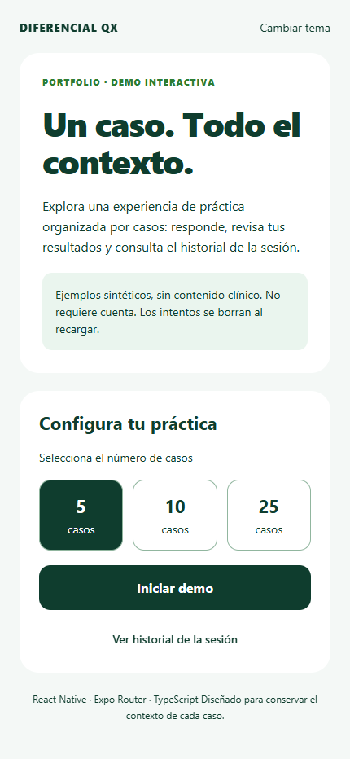
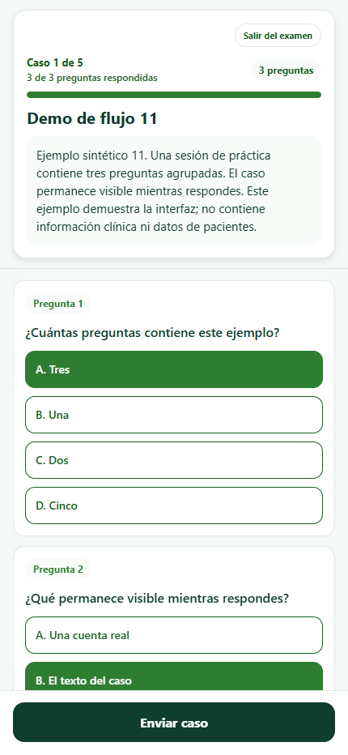
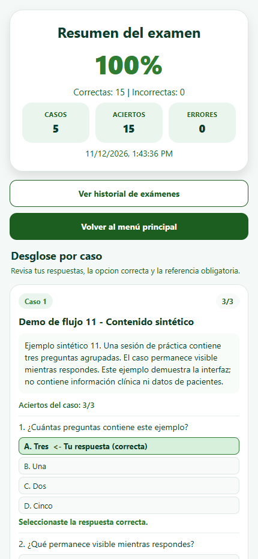
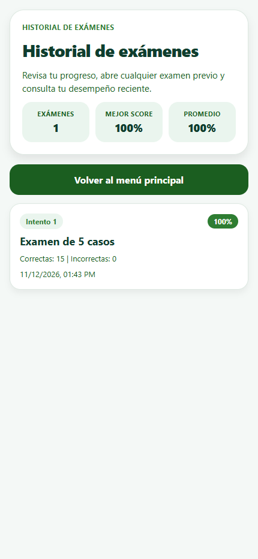
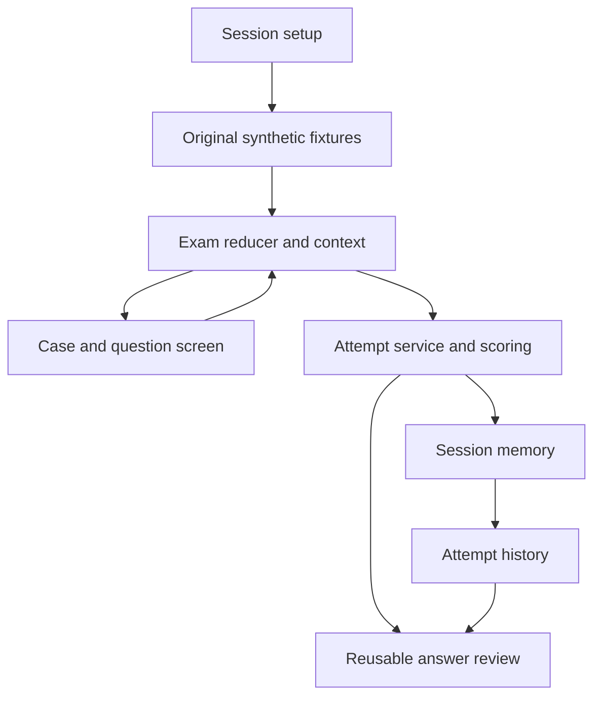

# Diferencial QX

**A case-based exam experience built with React Native, Expo Router, and TypeScript.**

This portfolio edition demonstrates the interaction and state architecture of a Spanish-language surgery exam simulator. It preserves the case, question, scoring, and review flow while replacing private educational content with original, non-clinical software examples.

No account, credentials, payment, or backend connection is required. Demo attempts live in memory and disappear when the app reloads.

## Product walkthrough

1. Choose a practice session of **5, 10, or 25 cases**.
2. Answer three questions per demo case while keeping its context visible.
3. Submit each complete case and progress through the session.
4. Review the score, individual answers, and reference for each case.
5. Reopen completed attempts from the current session's history.

The interface retains Spanish copy for its intended audience. Project documentation is in English.

## Screenshots

Captured from the running web edition at a mobile viewport, using synthetic demo content only.

| Session setup | Case and questions |
| --- | --- |
|  |  |

| Results and answer review | Session history |
| --- | --- |
|  |  |

## Engineering highlights

- **Case integrity:** randomize entire cases, preserve question order, and prevent duplicate cases in a session.
- **Centralized state:** a reducer governs answer selection, case submission, and exam completion.
- **Reusable review UI:** the same review component supports immediate results and historical attempts.
- **Separated data boundary:** UI and state depend on an attempt service; this edition uses a session-only adapter.
- **Light and dark themes:** shared theme state controls the exam and review screens.

## Run locally

Use Node.js 22 LTS or later and npm.

```sh
npm ci
npm run web
```

Open the local address printed by Expo. For native development, run `npm start` and use a compatible simulator or Expo environment. Native device behavior has not been certified by this portfolio review.

```sh
npm run typecheck
npm run lint
npm test
npm run export:web
```

## Architecture



See [architecture](docs/ARCHITECTURE.md), [security boundaries](SECURITY.md), and [content provenance](docs/PROVENANCE.md).

## Scope and limitations

This is a disconnected portfolio edition, not the production application. Authentication, purchases, cloud storage, deployment configuration, original assets, and the private question bank are intentionally outside its scope. The 25 fixtures repeat a simple three-question interaction pattern with distinct case identifiers; they are not a medical curriculum.

Scoring occurs on the client for demonstration. Session memory is not a secure multi-user store. Reloading loses both completed attempts and in-progress work. This software does not provide medical advice or clinical assessment.

## Rights

No open-source license is granted by this preparation. Publication and any license choice remain subject to the project owner's confirmation of source-code and brand rights. Third-party packages retain their respective licenses.
